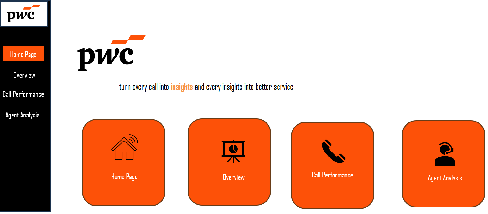
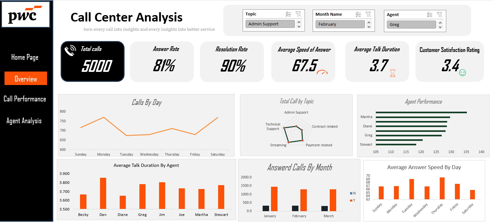

# PwC Call Center Analysis | Excel Dashboard

## Project Overview

This project analyzes call center operations using Microsoft Excel to transform raw call data into actionable business insights.

The interactive dashboard provides an overview of operational efficiency, agent performance, call resolution, response times, and customer satisfaction. It enables users to explore call center performance at both the overall and individual agent levels.

The report consists of four dashboard pages:

- **Home Page:** Navigation to the dashboard sections.
- **Overview:** High-level call center performance metrics.
- **Call Performance:** Call handling efficiency and topic-level analysis.
- **Agent Analysis:** Individual agent performance and resolution comparisons.

## Business Objectives

- Monitor call center performance and operational efficiency.
- Analyze answered and unanswered calls.
- Evaluate resolution rates across agents and call topics.
- Measure average speed of answer and talk duration.
- Monitor customer satisfaction.
- Identify agent strengths and areas for improvement.
- Explore call volume patterns across days and months.
- Support data-driven decisions related to staffing, training, and service quality.

## Dashboard Preview

### 1. Home Page

The landing page provides navigation to the dashboard sections, allowing users to move between different areas of the analysis.

### 2. Overview

The Overview page presents a high-level summary of call center performance through key performance indicators (KPIs) and interactive visualizations.

**Key Performance Indicators (KPIs)**

- Total Calls
- Answer Rate
- Resolution Rate
- Average Speed of Answer
- Average Talk Duration
- Customer Satisfaction Rating

**Visualizations**

- Calls by Day
- Total Calls by Topic
- Agent Performance
- Average Talk Duration by Agent
- Answered vs. Unanswered Calls by Month
- Average Speed of Answer by Day

### 3. Call Performance

The Call Performance page focuses on call handling efficiency, missed calls, and resolution performance across different call topics.

**Key Performance Indicators (KPIs)**

- Missed Calls Rate
- Resolution Rate
- Average Speed of Answer
- Average Talk Duration
- Customer Satisfaction Rating

**Visualizations**

- Answered vs. Unanswered Calls by Topic
- Answer Rate by Day
- Missed Calls Rate by Topic
- Resolution Rate by Topic

### 4. Agent Analysis

The Agent Analysis page compares individual agent performance, helping identify differences in productivity, response times, customer satisfaction, and resolution outcomes.

**Key Performance Indicators (KPIs)**

- Total Agents
- Top Performer
- Average Speed of Answer
- Average Talk Duration
- Customer Satisfaction Rating

**Visualizations**

- Agent Performance Comparison
- Answered vs. Unanswered Calls by Agent
- Average Speed of Answer vs. Customer Satisfaction
- Answer Rate vs. Resolution Rate by Agent
- Resolution Rate by Agent and Topic Heatmap

The heatmap highlights differences in resolution performance across agents and topics. These differences can help managers identify potential coaching opportunities and areas that may benefit from additional training.

## Dataset Description

The dataset contains call-level records with the following columns:

| Column | Description |
|---|---|
| `Call Id` | Unique identifier for each call. |
| `Agent` | Agent responsible for handling the call. |
| `Date` | Date on which the call occurred. |
| `Time` | Time at which the call occurred. |
| `Topic` | Category or subject of the call. |
| `Answered (Y/N)` | Indicates whether the call was answered. |
| `Resolved` | Indicates whether the customer's issue was resolved. |
| `Speed of answer in seconds` | Time taken to answer the call, measured in seconds. |
| `AvgTalkDuration` | Duration of the call. |
| `Satisfaction rating` | Customer satisfaction score recorded for the call. |

## Tools and Techniques

- **Microsoft Excel:** Dashboard development, analysis, and visualization.
- **Power Query:** Data cleaning and transformation.
- **Power Pivot / Data Model:** Data modeling and relationships between tables.
- **PivotTables and PivotCharts:** Data aggregation and visualization.
- **Excel Formulas and Measures:** KPI calculations and performance metrics.
- **Slicers:** Interactive filtering of dashboard data.
- **Conditional Formatting:** Heatmap visualization for agent-topic comparisons.
- **Data Visualization:** KPI cards, bar charts, line charts, stacked column charts, scatter plots, and matrix-style analysis.

## Key Performance Indicators

| KPI | Definition |
|---|---|
| Total Calls | Total number of call records in the dataset. |
| Answer Rate | Answered Calls / Total Calls × 100. |
| Missed Calls Rate | Unanswered Calls / Total Calls × 100. |
| Resolution Rate | Resolved Answered Calls / Answered Calls × 100. |
| Average Speed of Answer | Average time taken to answer calls, measured in seconds. |
| Average Talk Duration | Average duration of calls. |
| Customer Satisfaction Rating | Average of available customer satisfaction scores. |

### KPI Formulas

**Answer Rate**

`Answer Rate = (Answered Calls / Total Calls) × 100`

**Missed Calls Rate**

`Missed Calls Rate = (Unanswered Calls / Total Calls) × 100`

**Resolution Rate**

`Resolution Rate = (Resolved Answered Calls / Answered Calls) × 100`

The resolution rate measures the percentage of answered calls that resulted in a resolved customer issue. Calls that were not answered should not be included in the resolution rate denominator.

## Key Business Insights

The following observations are based on the dashboard analysis and should be validated against the underlying dataset and calculations before being used for operational decisions.

1. **Resolution Performance:** Reported resolution rates are generally strong across agents and topics, with values mostly in the upper-80% to low-90% range.

2. **Technical Support:** The reported missed-call rate is relatively high for Technical Support despite strong resolution performance. This may warrant further investigation into call demand, staffing levels, and queue management.

3. **Agent Performance:** Differences in agent productivity, response times, and resolution performance can help managers identify strong performers and potential coaching opportunities.

4. **Topic-Level Skill Gaps:** The resolution heatmap highlights differences across agent-topic combinations, making it easier to identify areas for targeted training.

5. **Call Volume Patterns:** Reported call volume peaks on Mondays and Saturdays. Comparing these periods with answer rates and response times may help inform staffing decisions.

6. **Customer Satisfaction:** The scatter plot explores the relationship between speed of answer and customer satisfaction. Any observed relationship should be investigated further and should not be interpreted as proof of causation.

## Business Value

This dashboard supports data-driven decision-making by helping call center managers:

- Monitor operational KPIs in one place.
- Identify missed-call and resolution performance gaps.
- Compare agent performance and service outcomes.
- Investigate topic-level service bottlenecks.
- Identify opportunities for agent coaching and training.
- Explore call volume patterns to support staffing decisions.
- Monitor customer satisfaction and service efficiency.

## How to Use

1. Clone or download this repository.
2. Open the Excel workbook in Microsoft Excel.
3. Navigate between the dashboard pages.
4. Use the available slicers to filter the report.
5. Compare KPIs and visualizations to investigate performance patterns.
6. Review the underlying data and KPI definitions before making business recommendations.

## Project Summary

- **Domain:** Call Center Analytics
- **Category:** Data Analytics and Business Intelligence
- **Tools:** Microsoft Excel, Power Query, Power Pivot / Data Model
- **Techniques:** Data Cleaning, Data Modeling, KPI Analysis, Interactive Dashboards, and Data Visualization
- **Deliverable:** Interactive multi-page Excel dashboard

---

*This is an independent portfolio project inspired by a PwC-style call center dashboard. It is not an official PwC publication or endorsement.*
